<p align="center">
  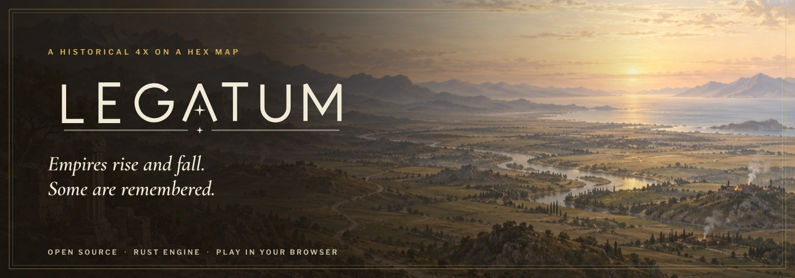
</p>

<p align="center">
  <a href="LICENSE"></a>
  <a href="LICENSE-ART"></a>
  
  
  
</p>

<h3 align="center">A historical 4X on a hex map, built for people who love Civilization.</h3>

<p align="center">
  Real peoples, from Switzerland to the Aztecs. Play solo against one to seven AI empires, or with a friend on one team against six.<br>
  Everyone plans at once, the race to victory is always visible, and the AI gets no bonuses at Easy, Normal or Hard.
</p>

<p align="center">
  <a href="docs/media/legatum-teaser.mp4">
    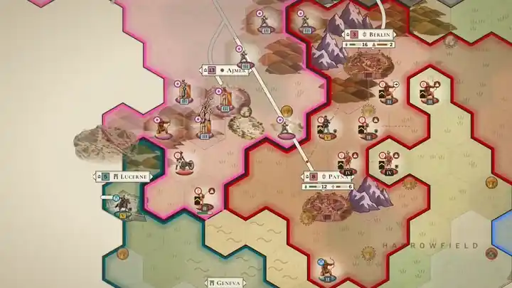
  </a>
  <br>
  <sub>Click to watch the 40-second teaser, recorded from the running game. Sound on.</sub>
</p>
<!-- teaser-player -->

<p align="center">
  <a href="#why-its-different">Why it's different</a> ·
  <a href="#see-it">See it</a> ·
  <a href="#play-it">Play it</a> ·
  <a href="#how-it-works">How it works</a> ·
  <a href="#determinism-and-simulation">Determinism and simulation</a> ·
  <a href="#how-it-was-made">How it was made</a> ·
  <a href="#roadmap">Roadmap</a> ·
  <a href="#contributing">Contributing</a>
</p>

---

Legatum is a turn-based strategy game in the tradition of Civilization VI. You found cities, research through nine eras, raise armies, make and break alliances, and race your rivals for victory points. A full game is paced for about 300 turns.

It is an open-source project in active development. The game runs today in a browser and as a Mac app, and two or more players can play online. There is no stable release yet; see [Status](#status).

## Why it's different

These are the design rules the project holds itself to. Where the game falls short of one, that is a bug.

- **Familiar on purpose.** If you have played Civilization VI you already know the basics: found cities, pick research, queue production, fight on hexes. Where Legatum differs, the change is deliberate.
- **Nobody waits.** Turns are simultaneous. Every empire, human or AI, plans at the same time, and the engine resolves all the orders together in fixed stages.
- **No hidden maths.** Yields, costs and combat strengths open into a breakdown. Attacks, advances and Peace offers show a forecast before you commit.
- **The race is always visible.** Victory points (VP) are public from turn one. Era objectives, faction goals, world wonders and captured capitals are on one screen, with who holds each. A team that holds its target for ten turns wins, so a leader is on a clock everyone can see.
- **Eleven peoples, nine of them finished.** Switzerland, India, Byzantium, Germany, the Celts, the Mongols, Sparta, Athens and the Aztecs each have a signature strength, a drawback that pays for it and a faction goal worth 2 VP. Egypt and Rome are playable early designs with no faction goal yet. <!-- peoples-count -->
- **An AI that plays by your rules.** Easy, Normal and Hard get no extra yields, no cheaper costs, no stronger units and no extra sight. Each AI empire plans from the same fogged view a player in its seat would have. A harder level decides better. The exact scope is under [What the AI can see and do](#what-the-ai-can-see-and-do).
- **Strategy with a counter.** Rushing, expanding wide, turtling, building an economy and playing diplomatically are each designed to have an answer, so the best plan depends on your people, the map and your neighbours. Expansion, by settling or by conquest, is the core loop. Staying small is deliberately weak.
- **Close to the end.** A leader can pull ahead, but each technology costs less for every other empire that already knows it, a public warning names whoever is closest to winning, and the Hard AI will go to war to contain them.
- **The next action is obvious.** The aim is one clear primary button on each screen and a reason on anything you cannot do.

## See it

These clips are recorded from the running game.

<p align="center">
  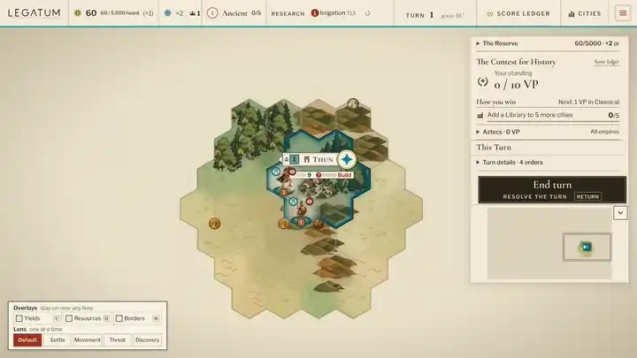
  <br><sub><b>The first turns move.</b> Your capital is already standing on turn 1. Send your units exploring and the map opens up, with discoveries along the way.</sub>
</p>

<p align="center">
  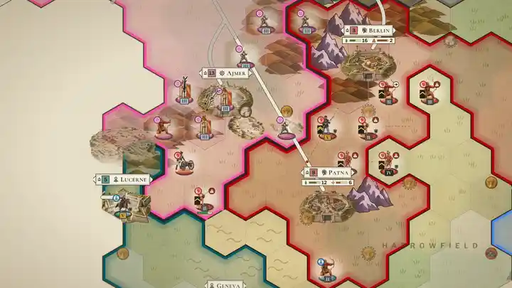
  <br><sub><b>Every order resolves at once.</b> Ranged fire, then movement and melee, for every empire together. Before you commit, a forecast card shows both strengths, the expected damage and your odds.</sub>
</p>

<p align="center">
  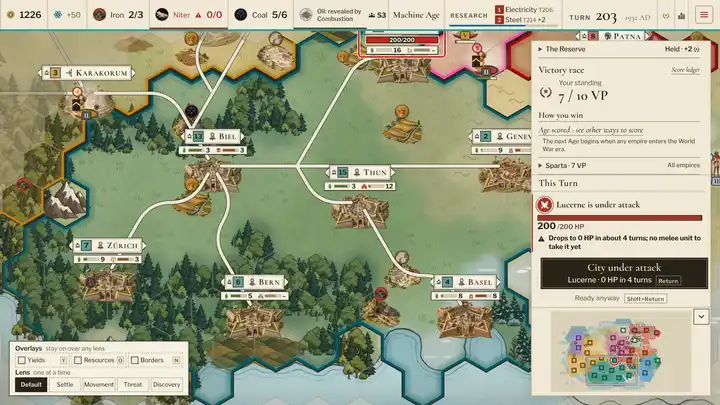
  <br><sub><b>A map at turn 203.</b> Eight empires, roads, borders and a city under attack.</sub>
</p>

<p align="center">
  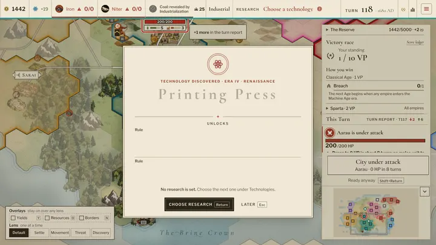
  <br><sub><b>Eras you feel.</b> Entering one is a celebrated moment: new units and buildings, the three objectives that score its victory point, and your cities rebuilt in the new style.</sub>
</p>

<table align="center">
  <tr>
    <td width="50%">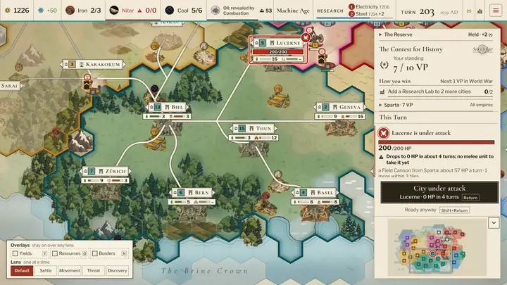</td>
    <td width="50%">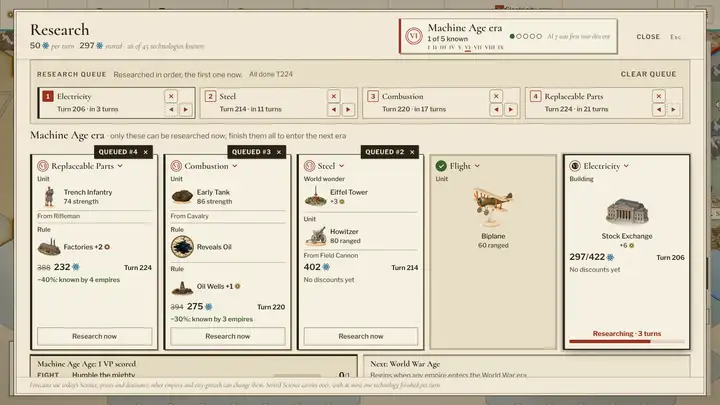</td>
  </tr>
  <tr>
    <td valign="top"><sub><b>The race is always visible.</b> Who holds which wonder, who has scored which era, and one ledger for every point in the game.</sub></td>
    <td valign="top"><sub><b>Technologies worth wanting.</b> Every unlock is illustrated, and a hover shows what it beats, what it loses to and how it compares with what it replaces.</sub></td>
  </tr>
  <tr>
    <td width="50%">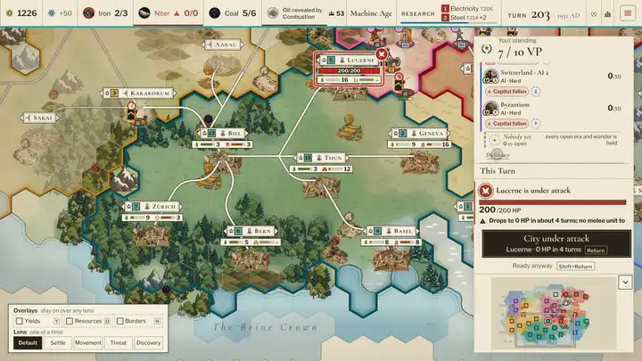</td>
    <td width="50%">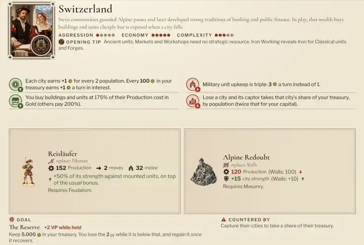</td>
  </tr>
  <tr>
    <td valign="top"><sub><b>Diplomacy shows its reasoning.</b> When an empire refuses a proposal, the inbox lists every factor in its decision.</sub></td>
    <td valign="top"><sub><b>Choosing a people.</b> Every strength is paired with the price that pays for it.</sub></td>
  </tr>
</table>

## What is in the game

- **A hex map.** Fog of war, terrain, resources, improvements you build from a city's production list, roads, eight natural wonders (real ones, such as Mount Fuji and Victoria Falls), barbarian camps and ruins.
- **Nine eras, 45 technologies.** You finish an era's five technologies to enter the next, in any order. From the Classical era on, new units and key buildings need a strategic resource (Iron, Niter, Coal, Oil or Silicon). <!-- eras-count -->
- **Three land unit classes and aircraft.** Until the World War era the melee line beats mounted units and mounted units beat ranged units, each by a bonus the forecast shows. Aircraft arrive with Flight in the Machine Age.
- **Diplomacy with Peace, Alliance and War.** An Alliance fights as one side, a call to arms is one decision card, and a public warning shows when rivals line up against a leader.
- **Asymmetric peoples.** Each has its own rules, units or buildings, and a drawback that pays for them.
- **A public victory race.** A team wins by holding its VP target for ten turns: 10 VP for one empire, 20 for a team of two. VP come from era objectives (1 VP in each era after the first, with three ways to score it), captured original capitals, world wonders and faction goals. A team also wins when it is the only one still holding an original capital of its own.
- **Solo or together.** Single Player is you against one to seven AI empires (five by default). Multiplayer is hot seat on one computer or an online game: Host Game lists your game for others and Join Game shows the games that are open (all games are public for now). The game runs in the host's browser tab, so it ends for everyone if the host closes the tab. The co-op setup puts two humans on one team against six AI empires.
- **Scenarios.** Short positions that each ask one question ("can you hold this city?"), with the Hard AI's result from the same start to compare against.
- **Art and sound.** All of the art is AI-generated (see [How it was made](#how-it-was-made)). The music and sound effects are CC0 recordings by Kenney and others, credited in the game.
- **A post-game report.** The victory race over time, empires over time, an event timeline and a statistics table.

## Play it

**[Play in your browser](https://legatum-game.pages.dev).** Nothing to install. Single player against the AI, hot seat on one computer and the scenarios all work there; online games work there too. It is made for a laptop or desktop with a keyboard and mouse and a current browser (it is tested in Chrome); the phone is not a target. The first load is about 7 MB. Your game is autosaved in that browser, and Menu → Save to file gives you a copy to keep. The game's record is also uploaded to the project, without player names; see [Privacy](#privacy).

**Mac app.** [Download the latest release](https://github.com/samcorcos/legatum/releases/latest) (macOS 11 or later, Apple silicon and Intel). It is signed and notarized with Apple. Open the disk image and drag Legatum to Applications.
<!-- mac-download -->

### Privacy

Every game played in the browser version is uploaded to us, so we can measure how well the AI plays and find bugs.

- **What is sent:** the game's record: the setup, every turn's orders, the score each turn and how long turns took. Player names are replaced with "Player 1", "AI 2" and so on before anything leaves your browser, and the server refuses a record with any other name.
- **What is not sent:** no account, no email, no cookies and no tracking. Legatum keeps no IP addresses or request logs.
- **Who can read it:** the records are stored privately and only the maintainer can read them. They may be used to train and test the game's AI.
- **Turning it off:** uploads cannot be turned off in the browser version. The Mac app and builds from source upload nothing.

### Build it from source

You need [rustup](https://rustup.rs/) (the checked-in toolchain file installs Rust 1.98.1, rustfmt, clippy and the WebAssembly target), [`wasm-pack`](https://wasm-bindgen.github.io/wasm-pack/installer/) 0.15.0, Node.js 22 (see `.nvmrc`), npm and Python 3 (the build and test scripts use it). The Mac app also needs the Xcode command line tools.

**In a browser:**

```sh
git clone https://github.com/samcorcos/legatum && cd legatum
nvm use                          # or install Node.js 22 by another method
scripts/build-wasm.sh            # builds the engine as WebAssembly into app/src/wasm-pkg
cd app && npm ci && npm run dev  # serves the game at http://localhost:5173; open that in your browser
```

The first engine build compiles the whole Rust engine with full optimisation and takes several minutes (often 5 to 15); later builds are much faster. `scripts/build-wasm.sh --dev` gives a slower-running engine sooner, for a quick look. If the build fails while downloading `wasm-opt`, run `LEGATUM_WASM_NO_OPT=1 scripts/build-wasm.sh` to skip that optimisation step.

**As a Mac app:**

```sh
scripts/build-mac-app.sh         # add --dmg for a disk image
open app/src-tauri/target/release/bundle/macos/Legatum.app
```

An app you build yourself is unsigned, so on another Mac Gatekeeper asks you to right-click and choose Open the first time.

**Online** (no addresses or Terminal): Host Game runs the game inside the host's browser tab and lists it on a small Cloudflare relay (`infra/relay`); guests choose it from Join Game. The game, the AI and the saves stay in the host's tab; the relay only lists games and passes messages. Everyone needs the same build. The contract is [plans/online-play.md](plans/online-play.md).

New to the game? The in-app Guide covers the rules, and [docs/rules/](docs/rules/) is the code-checked reference for how everything works.

## How it works

Legatum is one deterministic Rust engine with thin hosts around it. The app (including the host of an online game) and the simulation runner all drive the same code, so there is only one copy of the rules.

<p align="center">
  <picture>
    <source media="(prefers-color-scheme: dark)" srcset="docs/media/diagrams/architecture-dark.svg">
    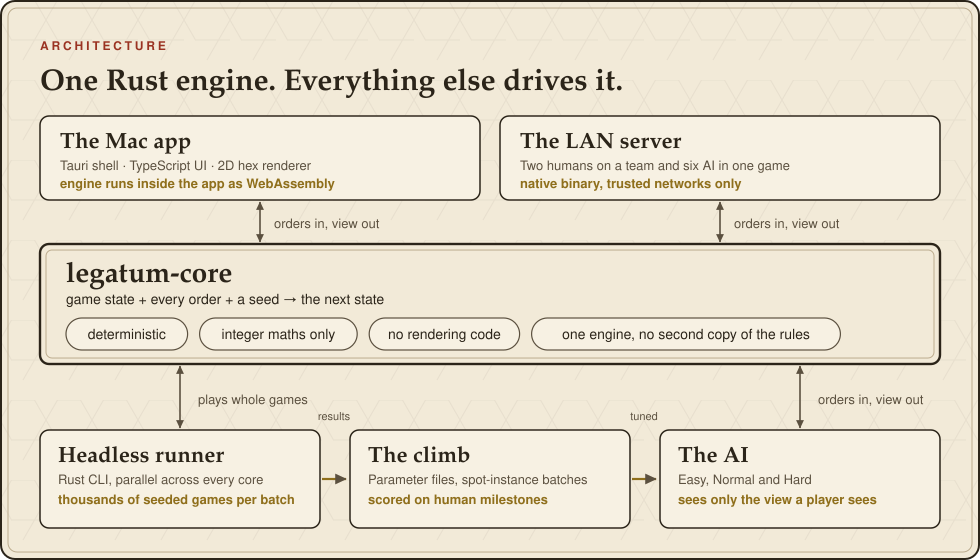
  </picture>
</p>

A turn is a pure function: the state, every player's orders and a seed go in, the next state comes out. Humans and AI plan at the same time, and the engine resolves the turn in fixed stages.

<p align="center">
  <picture>
    <source media="(prefers-color-scheme: dark)" srcset="docs/media/diagrams/simultaneous-turns-dark.svg">
    
  </picture>
</p>

### What the AI can see and do

<p align="center">
  <picture>
    <source media="(prefers-color-scheme: dark)" srcset="docs/media/diagrams/ai-no-cheating-dark.svg">
    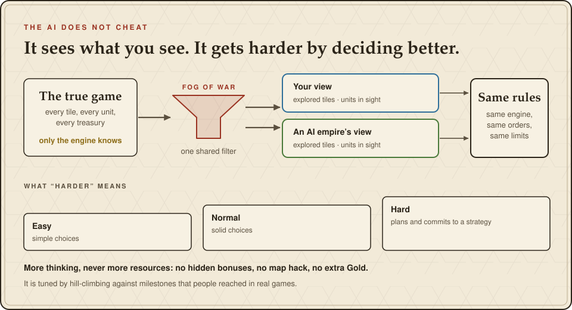
  </picture>
</p>

The game offers three AI levels: Easy, Normal and Hard. For all three:

- **Same view.** An AI seat is given a `PlayerView`, the fogged view a player in that seat would see, and returns orders (`Brain` in `crates/ai/src/lib.rs`, `Session::ai_orders` in `crates/wasm/src/session.rs`). What it remembers about rivals is built from its own earlier views.
- **Same rules.** The rules in `crates/core` do not branch on a seat's level or on whether it is human. No level changes yields, costs, combat strength, starting units or sight.
- **The level changes decisions only** (`crates/ai/src/difficulty.rs`). Easy keeps smaller armies, attacks only with a big edge and lets about one planned order in five lapse. Hard keeps a bigger army and adds strategic plans: it pursues one objective at a time (a campaign against a city, containing the leader, or peace and economy) and ends it only for a recorded reason (`crates/ai/src/plan.rs`).

Two research tools in this repository can read the full game state: a search diagnostic in the simulator, and the battle-study code that produces training data for future AIs. Each needs its own setup flag, which Easy, Normal and Hard do not set. The simulator can also run Hard with a forward search that plays candidate plans on the real engine from the seat's own fogged view.

AI strength is measured. The AI is scored against milestones recorded from human games, and its parameters are tuned by hill-climbing on rented compute and checked on games it has not seen. It is not yet as good as a strong human, which is why that work is first on the [Roadmap](#roadmap).

## Determinism and simulation

The engine uses integer maths only, seeded random streams for each purpose and no dependence on map iteration order, so the same state, orders and seed give the same result on every machine and in the browser.

- **Cross-target check.** In the last full cross-target run (2026-09-26, on an earlier rules version), 30 games (2,398 turns) were played natively in debug and release and in WebAssembly. Every recorded turn hash matched, including after saving and loading in the middle of a game. The report is [docs/sim-results/2026-09-26-cross-target-determinism.md](docs/sim-results/2026-09-26-cross-target-determinism.md), and `scripts/wasm-tape-check.mjs` re-runs the idea against fixed tapes.
- **Replays are exact.** Every game records its orders and a per-turn state hash. Pinned tapes in `crates/sim/tests/` fail when any rule change moves an outcome, and `tools/sim/repin.sh` makes an intended change explicit.
- **Fast enough to measure with.** A late turn (201+) of an 8-empire Standard game, End Turn plus the follow-up view, took about 22 ms on one native thread after the 2026-10-24 performance pass, down from 40 ms. That was measured before the Machine Age and Modern eras were added. The method and history are in [docs/sim-results/perf/](docs/sim-results/perf/). Larger batches run on rented many-core machines.
- **Balance and AI quality are numbers.** `legatum-sim` plays AI-only games in parallel and writes win rates, pacing and per-people results. Past reports are in [docs/sim-results/](docs/sim-results/); the raw per-game output is not in this repository. Scenario files in `scenarios/` pin short wars cut from human games, each scored against what the human achieved.

```sh
cargo run --release -p legatum-sim -- --games 20 --players 4 --map-size small --label smoke
```

The crate map, the turn pipeline and the determinism rules are in [ARCHITECTURE.md](ARCHITECTURE.md).

## How it was made

Legatum is built largely with AI coding agents, and all of its art is AI-generated. Most of the art comes from OpenAI's image models through ChatGPT; the icons and heraldry are SVG drawn by scripts in this repository. The working files are public so that other people can learn from them:

- [CLAUDE.md](CLAUDE.md) is the standing brief the agents work under: the design pillars, where each kind of knowledge lives, and the review gates.
- [.claude/skills/](.claude/skills/) holds what an agent loads before a task: the code-checked rules reference, and the design, faction, UI, art and workflow notes with the decisions behind them.
- [docs/learnings.md](docs/learnings.md) is the unedited engineering log: bug causes, balance findings and dead ends.

[docs/README.md](docs/README.md) indexes the rest, including the simulation reports and playtest reviews.

## Status

Pre-release and moving fast. Rules, content and balance change often, and a save from an older rules version is refused with a clear message instead of being migrated. The Mac app is the target that is exercised most. The web build is played through a short game in Chromium before every deploy; other browsers and the Rust crates on other systems should work but are not routinely tested. An iPad and iPhone build runs in the iOS Simulator; it is experimental and unsupported.

## Roadmap

Direction, in rough order of how soon it matters:

- **An AI that plays like a strong human.** The AI is being tuned against milestones recorded from human games, and it has not reached its targets yet. This comes before faction balance work, because balance numbers mean little while the AI is weak.
- **Finishing Egypt and Rome.** Neither has a faction goal yet.
- **Faction balance.** The aim is that the best people's win rate is at most 1.5 times the worst's, checked on about 2,000 games plus held-out seeds. Balance changes add drawbacks or deepen a weak identity; they do not flatten strengths.
- **A late-game way to score for stalemated games.** A stalled game should have a hard path to two more points in the Future era. It waits until simulations show it is needed.
- **Delegation for the mid-game.** War across a big empire is tedious by hand. Generals who run a campaign for you are planned once the AI's own campaign logic is good enough to trust.
- **More platforms.** Windows and Linux builds of the app, from the same web UI, are open for contribution.

## Contributing

Issues and pull requests are welcome from anyone. The maintainer decides what merges. [CONTRIBUTING.md](CONTRIBUTING.md) covers setup, the test commands and the rules the project holds to: one engine, determinism, pinned tapes, versioned saves and an AI with no bonuses. Please also read [CODE_OF_CONDUCT.md](CODE_OF_CONDUCT.md) and [SECURITY.md](SECURITY.md).

## Licence

The code is MIT licensed ([LICENSE](LICENSE)). The art is AI-generated and is offered under CC BY 4.0 to the extent rights exist ([LICENSE-ART](LICENSE-ART)). The music and sound effects are third-party CC0 works, credited in [app/public/audio/CREDITS.md](app/public/audio/CREDITS.md). The interface bundles the Cormorant and Libre Franklin typefaces under the SIL Open Font License. Dependencies are listed in [THIRD_PARTY_NOTICES.md](THIRD_PARTY_NOTICES.md).

Legatum is an independent project and is not affiliated with, endorsed by or derived from Sid Meier's Civilization, Take-Two Interactive Software, Inc. or Firaxis Games; "Civilization" is their trademark and is named only to describe the genre.
