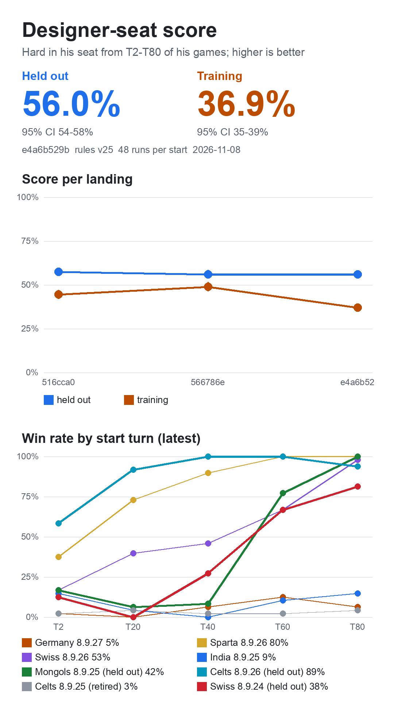

# Designer-seat score

The headline AI metric from 2026-11-07 (plan: `docs/design/ai-strategy/fable-2026-11-07.md` §4.1, §6). It answers one question: **is Hard getting better against him?**



## Control (frozen): master `516cca016`, `RULES_VERSION` 21, 2026-11-07

| | Score | 95% interval |
|---|---:|---|
| **Held out** (the target) | **57.4%** | 55.1 to 59.6 |
| Training | 44.4% | 41.9 to 47.0 |
| Held out with Celts 8.9.25 instead of 8.9.26 (the set before 2026-11-07 evening) | 29.0% | 27.1 to 31.0 |

**Read the held-out number with care:** Celts 8.9.26 was an easy win and Hard converts it 88% of the time even from T2, so it sits near the ceiling and adds little signal; the held-out score's movement will come mostly from Mongols 8.9.25 and Swiss 8.9.24. The plan's checkpoint target ("held out 40%, from about 20%") was set for the old set and is already passed on paper; it needs restating against this control.

| Tape | Set | Score | T2 | T20 | T40 | T60 | T80 | Recorded on |
|---|---|---:|---:|---:|---:|---:|---:|---|
| Sparta 8.9.26 (win T122) | training | 70.8% | 17/48 | 20/48 | 37/48 | 48/48 | 48/48 | `514dbb8fe`, rules 19 |
| Swiss 8.9.26 (win T144) | training | 55.8% | 12/48 | 12/48 | 29/48 | 34/48 | 47/48 | `514dbb8fe`, rules 19 |
| India 8.9.25 (win T177) | training | 6.7% | 2/48 | 1/48 | 0/48 | 4/48 | 9/48 | `21613c28b`, rules 11 |
| Mongols 8.9.25 (unfinished, T85) | held out | 43.8% | 11/48 | 2/48 | 2/48 | 42/48 | 48/48 | `21613c28b`, rules 11 |
| Celts 8.9.26 (easy win T135) | held out | 87.9% | 34/48 | 40/48 | 46/48 | 47/48 | 44/48 | `514dbb8fe`, rules 19 |
| Celts 8.9.25 (win T159) | retired 11-07 | 2.9% | 2/48 | 1/48 | 4/48 | 0/48 | 0/48 | `21613c28b`, rules 11 |
| Swiss 8.9.24 (win T160) | held out | 40.4% | 0/48 | 0/48 | 20/48 | 33/48 | 44/48 | `a8463a971`, rules 10 |

Germany 8.9.27 (win T153) joined the training set on 2026-11-07 after the control: on master `25c1566fc` (`takeover_gap.py`, same turns and 48 runs) it scores **5.4%** (0/1/3/5/4 of 48 at T2–T80; recorded on `730e6aef2`, rules 21). It enters the training score at the next run, which will drop to about 35% on four tapes: a re-based set, not a regression. Review `docs/playtests/reviews/2026-11-07-8.9.27-germany.md`.

Aztecs 8.9.29 (win T116) joined the training set on 2026-11-08 (`aztecs-8929` in `TAPES`, commit `91ceec682`): on master (rules 25) it scores **23.3%** [20.3, 26.4] (0/48 at T2 and T20, 1/48 at T40, 44/48 at T80; the swing is T55 to T70, 10% to 94%). With it the training set is five tapes, and the next run's training score (about 34% from the `e4a6b529b` tape values) is re-based again, not a regression; compare against a control rerun on the same commit. Review `docs/playtests/reviews/2026-11-08-8.9.29-aztecs.md`.

Raw: [`docs/sim-results/designer-seat/2026-11-07-516cca016.json`](../sim-results/designer-seat/2026-11-07-516cca016.json); one row per run in [`history.jsonl`](../sim-results/designer-seat/history.jsonl). Each new point is compared with this control, or with a control rerun on the same commit if the tape set changes.

## What it measures

- Hard takes over his seat at T2, T20, T40, T60 and T80 of his own game and plays to the end, every other seat Hard with the memory it had at that turn; 48 runs per start turn, with AI seeds and dice reseeded (map and objectives fixed). 1,680 games with the retired tape.
- A tape's score is its mean win rate over the five start turns (the area under its takeover curve). A set's score is the mean of its tapes. **Higher means Hard converts his positions more often.** T2 tests the whole game; T80 mostly tests finishing a lead he built.
- **Held out means held out:** Mongols 8.9.25, Celts 8.9.26 and Swiss 8.9.24 are never searched, diffed into templates or tuned on. Celts 8.9.26 replaced Celts 8.9.25 on 2026-11-07, as planned; the retired tape is still measured (set `retired`, in no set score) so the old series can be read. To rotate a tape, edit `TAPES` in the script and rerun the control on one commit. New coached games go into training; the oldest training tape rotates into the held-out set.
- Intervals: Wilson per cell; normal for the means. A change of about 3 pp between two runs of the held-out score is outside the noise. The run is deterministic: the same commit gives the same numbers.

## How positions from older rules are carried forward

Each tape replays on its own recording engine (`audit_states` at the tag, patched by `patch_recording_engine.py`), which checks every recorded hash; `seat_run` from the measured commit then continues from those positions with the current rules and AI (the takeover tool's method). All seven tapes loaded with **0 states changed on load**: the rules changes from versions 10, 11 and 19 to 21 add fields with defaults, so no tape needed restamping or was dropped. A rule that changes an existing field would show up as a nonzero `states_changed_on_load` in the JSON: check those tapes before trusting a point.

Caveats:
- Mongols 8.9.25 is unfinished (the archive's in-progress tape, T85). It was decided enough by T80 for Hard to win 48/48 from there.
- India 8.9.25 here is his T177 win. The plan's "India 8.9.25 8% from T16, 56% from T22" came from the unfinished 8.9.25 India game, a different tape.
- The score measures Hard converting **his** positions; it does not include rivals getting harder against him. The eight-map gate's rivals-only row covers that.

## Running it

```sh
# After every AI landing (lead), on master. About 14 minutes on the Mac (16 cores, nice) once the cache is warm:
python3 tools/decision-audit/designer_seat.py --label "<branch>"
# Same on the cloud build box (measures this checkout's HEAD; no spot cost); the nightly does this:
python3 tools/decision-audit/designer_seat.py --where box --label nightly
# A gene or branch without landing it: --commit REF (local only), --no-history to keep it off the chart
python3 tools/decision-audit/designer_seat.py chart   # redraw docs/status/designer-seat.png
```

Prepared tapes and the recording engines are cached in `~/LegatumRuns/designer-seat/` (first run: about 6 minutes to build three tag engines; one cargo target dir per source tree, because `git archive` stamps files with the commit time and a shared target dir can keep a stale binary). Archived tapes are copied before use; live saves are never touched. `tools/sim/nightly.sh` runs the box form after the war suite and stamps `history.jsonl`. Send the PNG to his phone after every landing (`legatum-show-on-mobile`).

## Held-out set decision (lead, 2026-11-07)
Celts 8.9.26 is near the ceiling: Hard wins 34 of 48 from T2 and 88% overall, so it carries little signal. The **held-out set for the checkpoint is Mongols 8.9.25, Swiss 8.9.24 and Celts 8.9.25: 29.0% at control `516cca016`**. Celts 8.9.26 is reported as its own row, not scored. Checkpoint target: held out ≥ 40% (+11 pp).

## Rotation decision (lead, 2026-11-07)
The held-out set stays fixed at Mongols 8.9.25, Swiss 8.9.24 and Celts 8.9.25 until the checkpoint, so progress is measured against an unchanged yardstick. New tapes join **training** only. Germany 8.9.27 (Hard 5.4%, the most informative tape so far) joins training. Re-pick the held-out set at the checkpoint, from tapes that no search has touched.
